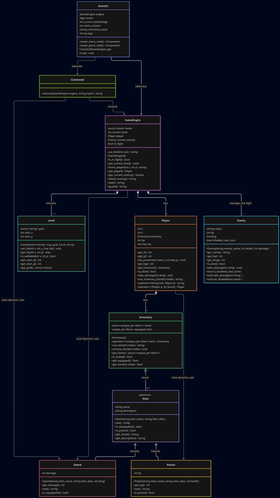

# Lerin
A fantasy-themed dungeon crawler developed as a university student project. Explore dungeons, battle monsters, and collect loot.

## Features & Controls

* **Movement:** `w` (up), `a` (left), `s` (down), `d` (right)
* **Combat:** 
  * `attack` — strike the enemy during an encounter (requires an equipped weapon)
  * `guard` — brace for impact, reducing incoming damage by 50%, with a 50% chance to stun the enemy for the current and next turn
  * `wait` — skip your action and pass the turn directly to the enemy
* **Inventory:** `use <slot>` — equip a weapon (e.g., `use 1`) or drink a potion to restore HP, `drop <slot>` — removes the item from the inventory (e.g., `drop 1`)
* **Status & System:** `info` (show equipped weapon & player stats), `quit` / `exit` (close the game), `help` (show commands that you can use)

## Map Legend

* `@` — Player
* `#` — Wall
* `.` — Floor (chance of random Enemy encounter)
* `C` — Treasure Chest (contains weapons/potions)
* `>` — Stairs to the next dungeon floor

## Object-Oriented Architecture

* **Inheritance & Polymorphism:** Base `Item` class with virtual methods (`use()`, `is_equippable()`, `is_potion()`) overridden by derived `Sword` and `Potion` classes, stored polymorphically via `std::unique_ptr<Item>` in `Inventory`.
* **Operator Overloading:**
  * `Inventory::operator+=` — adds new `std::unique_ptr<Item>` objects into the player's inventory.
  * `Player::operator+=` — applies healing boosts from potions to player HP.
  * `Player::operator+` — when added to another string it displays current `Player` health.
* **Encapsulation & Separation of Concerns:** Logic is decoupled from rendering across `GameEngine`, `Level`, `Player`, `Enemy`, `Inventory`, `Commands`, and `GameUI`.
* **Exception Handling:** Bounds checking and invalid input validation using `std::out_of_range` and `std::invalid_argument` caught cleanly in the UI command loop.



## Build & Run

### Prerequisites
* C++17 (or newer) compiler (`g++` / `clang++`)
* CMake 3.14+
* FTXUI (fetched automatically via CMake or installed on system)

### Compilation (Linux / macOS)
```bash
mkdir -p build && cd build
cmake ..
make
./Lerin